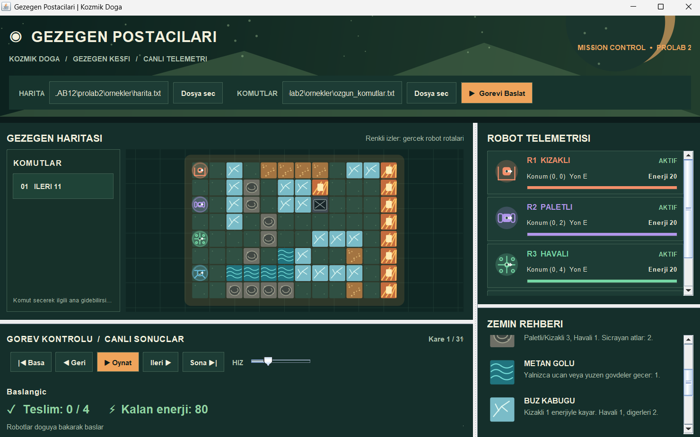

# Kozmik Doga V3 — Arayuz duzenlemeleri

- Robot telemetrisi: daha kisa kartlar, anlik konum/yon/enerji/durum ve enerji cubuklari.
- Sag ust/sag alt bolucu 4 robotu gostermeye daha fazla alan ayirir. Pencere kucukse dikey kaydirma calisir.
- Zemin rehberi: yatay kaydirma kapali, aciklamalar satira sigar, dikey kaydirma acik.
- Solda dikey komut listesi korunur; alttaki tekrarlanan yatay komut listesi kaldirildi.
- Harita: eski rotalar daha soluk, aktif robotlar halkayla, teslim edilenler isaretle gosterilir.

## Windows PowerShell (proje kok klasorunden)

```powershell
New-Item -ItemType Directory -Force out
javac -encoding UTF-8 -d out (Get-ChildItem src\*.java).FullName
java -cp out Main --gui
```

## Terminal testleri

```powershell
java -cp out Main ornekler\harita.txt ornekler\komutlar1.txt
java -cp out Main ornekler\harita.txt ornekler\komutlar2.txt
java -cp out Main ornekler\harita.txt ornekler\komutlar3.txt
```

Beklenen teslim/enerji: 2/43, 3/33, 4/26.

Not: GUI'nin Windows'taki ekran boyutlarinda gorunumu bu ortamda dogrudan test edilmedi.
